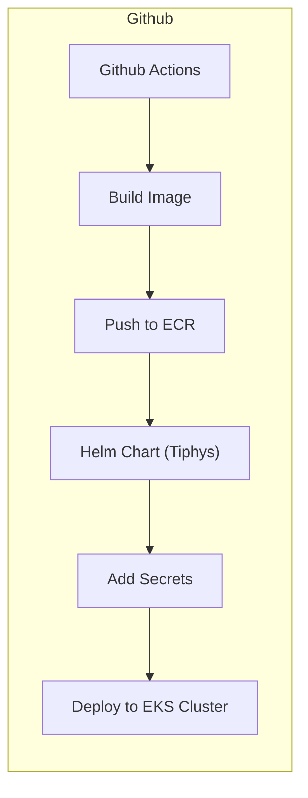
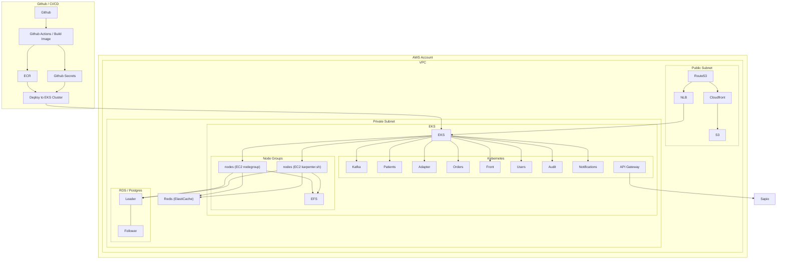
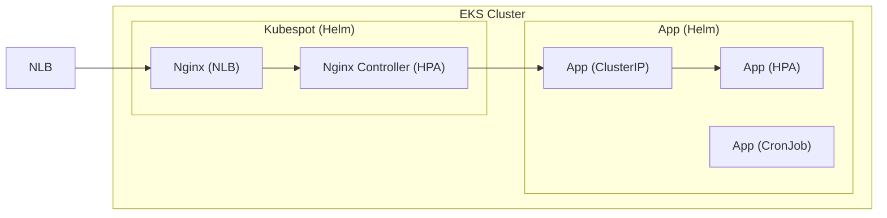
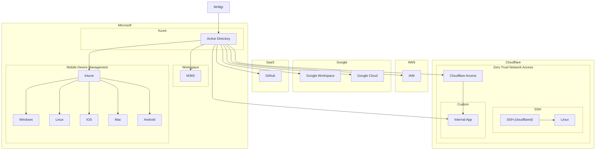

# Infra (Template)

[](https://github.com/opszero/template-infra)


opsZero uses Infrastructure as Code to build all infrastructure. The directory
structure contains everything needed to run the entire Cloud infrastructure from
DNS to IAM to the Cloud. The way different components are used is through
different terraform modules.

## Structure

- `dns`: DNS and Cloudflare Access
  - [terraform-cloudflare-edge](https://github.com/opszero/terraform-aws-mrmgr). Configure IAM resources including Github OIDC, Gitlab OIDC, and IAM.
- `identity`:
  - Setting up
- `monitoring`: Monitoring configuration
  - [terraform-datadog-panopticon](https://github.com/opszero/terraform-datadog-panopticon): Datadog powered panopticon.
- `environments`: Cloud Kubernetes Clusters, Common Cloud Terraform, Shared Terraform
  - `<environment>`: Individual environments. e.g prod, dev, staging.
    - Bastion
      - [terraform-aws-bastion](https://github.com/opszero/terraform-aws-bastion). AWS Bastion / Instance with EC2 Instance Connect
    - Kubernetes
      - [terraform-aws-kubespot](https://github.com/opszero/terraform-aws-kubespot). AWS Configuration
      - [terraform-helm-kubespot](https://github.com/opszero/terraform-helm-kubespot). Common Helm Charts.
  - `shared/<shared>`: Shared Terraform ~~modules~~ used by environments. e.g S3 Bucket configuration
  - `common/<common>`: Common Terraform ~~resources~~ used across environments. e.g ECR

# Architecture

## Deployment Pipeline



## AWS Cloud Infrastructure



## Kubernetes



## Identity (MrMgr)



# Compliance

To enable the compliance for SOC2, CMMC, HIPAA, ITAR, PCI-DSS please follow the
following:

- AWS module
  - `environments/common/compliance/aws-cloudtrail`: Setup Cloudtrail.
  - `environments/common/complaince/aws-elb`: Add monitoring to ELBs.
  - `environments/common/compliance/aws-guardduty`: Enable the Intrusion Detection System.

- `bin/aws-log-group-retention-update.py --profile <account> --region us-west-2`: Update the AWS Retention period to 365 days.

# Tools & Setup

```
brew install kubectl kubernetes-helm awscli terraform azure-cli
```

## Tasks

Tasks are defined in `tasks.py` using [invoke](https://www.pyinvoke.org/). Run `uv sync` first.

- `uv run invoke fmt`: Run `terraform fmt`

## Modules

- DevOps
  - Github Actions
    - [actions-cloudflare-dns](https://github.com/opszero/actions-cloudflare-dns)
    - [actions-deploytag](https://github.com/opszero/actions-deploytag)
    - [actions-deploytag-cleanup](https://github.com/opszero/actions-deploytag-cleanup)
    - [flowtune](https://github.com/opszero/flowtune)
    - [flowtune-runner-images](https://github.com/opszero/flowtune-runner-images)
    - [tiphys](https://github.com/opszero/tiphys)
  - Cloud
    - [wintune](https://github.com/opszero/wintune)
    - [nixtune](https://github.com/opszero/nixtune)
    - [opshell](https://github.com/opszero/opshell)
    - [terraform-aws-cloudflare-security-group](https://github.com/opszero/terraform-aws-cloudflare-security-group)
    - [terraform-aws-eks-efs](https://github.com/opszero/terraform-aws-eks-efs)
    - [terraform-aws-elb-cloudwatch](https://github.com/opszero/terraform-aws-elb-cloudwatch)
    - [terraform-aws-github-security-group](https://github.com/opszero/terraform-aws-github-security-group)
    - [terraform-aws-instance](https://github.com/opszero/terraform-aws-instance)
    - [terraform-aws-kubespot](https://github.com/opszero/terraform-aws-kubespot)
    - [terraform-aws-mongodbatlas](https://github.com/opszero/terraform-aws-mongodbatlas)
    - [terraform-aws-mrmgr](https://github.com/opszero/terraform-aws-mrmgr)
    - [terraform-aws-rds-cross-region-backup](https://github.com/opszero/terraform-aws-rds-cross-region-backup)
    - [terraform-aws-redshift](https://github.com/opszero/terraform-aws-redshift)
    - [terraform-aws-ssm](https://github.com/opszero/terraform-aws-ssm)
    - [terraform-cloudflare-domain](https://github.com/opszero/terraform-cloudflare-domain)
    - [terraform-datadog-panopticon](https://github.com/opszero/terraform-datadog-panopticon)
    - [terraform-github-mrmgr](https://github.com/opszero/terraform-github-mrmgr)
    - [terraform-helm-aws-vault](https://github.com/opszero/terraform-helm-aws-vault)
    - [terraform-helm-kubespot](https://github.com/opszero/terraform-helm-kubespot)
    - [terraform-kubernetes-socat](https://github.com/opszero/terraform-kubernetes-socat)
    - [terraform-template](https://github.com/opszero/terraform-template)
    - [terraform-azuread-mrmgr](https://github.com/opszero/terraform-azuread-mrmgr)
    - [terraform-azurerm-kubespot](https://github.com/opszero/terraform-azurerm-kubespot)
    - [terraform-google-kubespot](https://github.com/opszero/terraform-google-kubespot)
    - [terraform-google-mrmgr](https://github.com/opszero/terraform-google-mrmgr)
- DataOps
  - [airbase](https://github.com/opszero/airbase)
  - [terraform-aws-airflow](https://github.com/opszero/terraform-aws-airflow)
- Workflows
  - [template-aws-lambda-django](https://github.com/opszero/template-aws-lambda-django)
  - [template-aws-lambda-flask](https://github.com/opszero/template-aws-lambda-flask)
  - [template-azure-functions-django](https://github.com/opszero/template-azure-functions-django)
  - [template-helm-django](https://github.com/opszero/template-helm-django)
  - [template-helm-jupyter-voila](https://github.com/opszero/template-helm-jupyter-voila)
